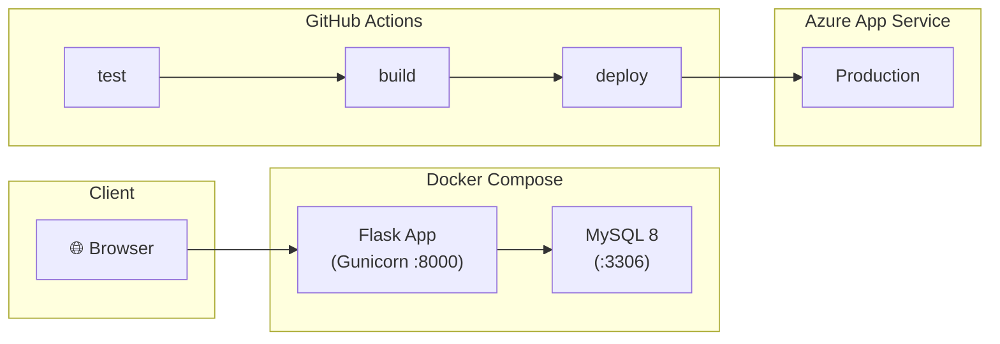

# 📚 Book Rental System


A Flask web application for browsing, renting, and managing books online, backed by MySQL.

---

## Architecture



## Features

| Feature | Endpoint |
|---|---|
| Home page | `GET /` |
| Browse genres | `GET /genre` |
| Books by genre | `GET /genre/<name>` |
| Book details | `GET /<book_id>` |
| Create account | `GET/POST /create_account.html` |
| Login / Logout | `GET/POST /login.html` · `GET /logout.html` |
| Update account | `GET/POST /update_account.html` |
| Delete account | `GET/POST /delete_account.html` |
| My rented books | `GET /mybooks.html` |
| Payment flow | `GET /payment.html` → `POST /confirm_payment.html` → `GET /thank_you.html` |

---

## Quick Start with Docker Compose

### Prerequisites

- [Docker Desktop](https://www.docker.com/products/docker-desktop/) installed and running

### Run

```bash
# Clone the repository
git clone https://github.com/<OWNER>/<REPO>.git
cd bookrental

# Start the app + MySQL
docker compose up --build

# App is available at http://localhost:8000
```

> [!NOTE]
> On first start MySQL needs ~30 s to initialize. The Flask container waits automatically via the healthcheck.

### Stop

```bash
docker compose down          # stop containers
docker compose down -v       # stop + delete the MySQL data volume
```

---

## Run Tests

```bash
# Install dependencies
pip install -r requirements.txt -r requirements-dev.txt

# Run the test suite
python -m pytest tests/ -v
```

Tests mock the database layer so **no running MySQL instance is required**.

---

## Environment Variables

| Variable | Default | Description |
|---|---|---|
| `DB_HOST` | `localhost` | MySQL hostname |
| `DB_USER` | `root` | MySQL username |
| `DB_PASSWORD` | `root` | MySQL password |
| `DB_NAME` | `books` | MySQL database name |

Copy `.env.example` to `.env` and edit as needed for local development.

---

## CI/CD Pipeline

The GitHub Actions pipeline (`.github/workflows/ci-cd.yml`) runs on every **push** and **pull request** to `main`:

| Job | Trigger | What it does |
|---|---|---|
| **test** | push + PR | Spins up a MySQL 8 service container, installs deps, runs `pytest` |
| **build** | after test passes | Builds the Docker image |
| **deploy** | push to main only | Deploys to Azure App Service |

### Required GitHub Secrets

You must create these in your repo at **Settings → Secrets and variables → Actions**:

| Secret | How to obtain |
|---|---|
| `AZURE_CREDENTIALS` | Create a service principal: `az ad sp create-for-rbac --name "bookrental-sp" --role contributor --scopes /subscriptions/<SUB_ID>/resourceGroups/<RG> --sdk-auth`. Paste the full JSON output. |
| `AZURE_WEBAPP_NAME` | The name of your Azure Web App (e.g. `bookrental-prod`) |

### Azure resources to create (step by step)

1. **Resource Group**: `az group create --name bookrental-rg --location eastus`
2. **App Service Plan**: `az appservice plan create --name bookrental-plan --resource-group bookrental-rg --sku B1 --is-linux`
3. **Web App** (container): `az webapp create --resource-group bookrental-rg --plan bookrental-plan --name bookrental-prod --deployment-container-image-name python:3.11-slim`
4. **Azure Database for MySQL** (optional, if not bundling MySQL): Create via Azure Portal or CLI.
5. **Service principal**: `az ad sp create-for-rbac --name "bookrental-sp" --role contributor --scopes /subscriptions/<SUB_ID>/resourceGroups/bookrental-rg --sdk-auth`
6. Add the JSON output as the `AZURE_CREDENTIALS` secret in GitHub.
7. Add the web app name (e.g. `bookrental-prod`) as the `AZURE_WEBAPP_NAME` secret.

---

## Project Structure

```
bookrental/
├── app.py                  # Flask routes
├── book1.py                # User DB operations (class DB)
├── book2.py                # Book queries (sugar, salt, masala)
├── book3.py                # Rental insertion (mub)
├── requirements.txt        # Production dependencies
├── requirements-dev.txt    # Test dependencies
├── Dockerfile              # Multi-layer Docker build
├── docker-compose.yml      # Flask + MySQL orchestration
├── .dockerignore
├── .env.example            # Environment variable template
├── static/                 # CSS, images
├── templates/              # Jinja2 HTML templates
├── tests/
│   ├── conftest.py         # Shared fixtures & DB mocking
│   └── test_endpoints.py   # 10 endpoint tests
└── .github/
    └── workflows/
        └── ci-cd.yml       # GitHub Actions pipeline
```

---

## License

This project is for educational purposes.
