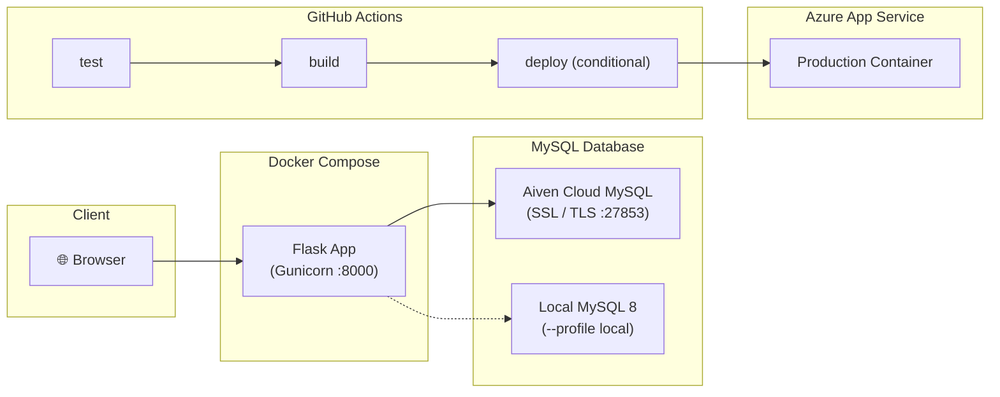

# 📚 Book Rental System

[](https://github.com/varshaa-1616/book-rental-system/actions/workflows/ci-cd.yml)

A Flask web application for browsing, renting, and managing books online, backed by MySQL (Aiven Cloud / Local).

---

## Architecture



## Features

| Feature | Endpoint |
|---|---|
| Home page | `GET /` |
| Browse genres | `GET /genre` |
| Books by genre | `GET /genre/<name>` |
| Book details | `GET /<book_id>` |
| Create account | `GET/POST /create_account.html` |
| Login / Logout | `GET/POST /login.html` · `GET /logout.html` |
| Update account | `GET/POST /update_account.html` |
| Delete account | `GET/POST /delete_account.html` |
| My rented books | `GET /mybooks.html` |
| Payment flow | `GET /payment.html` → `POST /confirm_payment.html` → `GET /thank_you.html` |

---

## Quick Start with Docker Compose

### Prerequisites

- [Docker Desktop](https://www.docker.com/products/docker-desktop/) installed and running
- A `.env` file configured with your MySQL connection details (copy from `.env.example`)
- `ca.pem` in project root for SSL (if using cloud MySQL like Aiven)

### Run with Cloud Database (Aiven)

```bash
# Clone the repository
git clone https://github.com/varshaa-1616/book-rental-system.git
cd book-rental-system

# Configure environment variables
cp .env.example .env
# Edit .env with your credentials

# Build and start the app
docker compose up -d --build

# App is live at http://localhost:8000
```

### Run with Local MySQL Container

```bash
# Start both app and local MySQL service
docker compose --profile local up -d --build
```

### Stop

```bash
docker compose down          # stop containers
docker compose down -v       # stop + delete any volumes
```

---

## Run Tests

```bash
# Install dependencies
pip install -r requirements.txt -r requirements-dev.txt

# Run the test suite
python -m pytest tests/ -v --tb=short
```

Tests mock the database layer so **no running MySQL instance is required**.

---

## Environment Variables

| Variable | Default | Description |
|---|---|---|
| `DB_HOST` | `localhost` | MySQL hostname |
| `DB_USER` | `root` | MySQL username |
| `DB_PASSWORD` | `root` | MySQL password |
| `DB_NAME` | `books` | MySQL database name |
| `DB_PORT` | `3306` | MySQL port (e.g. 27853 for Aiven) |
| `DB_SSL_DISABLED` | `false` | Set to `true` for local MySQL without SSL |
| `DB_SSL_CA` | `/app/ca.pem` | Path to CA certificate inside container |

---

## CI/CD Pipeline

The GitHub Actions pipeline (`.github/workflows/ci-cd.yml`) runs on every **push** and **pull request** to `main`:

| Job | Trigger | What it does |
|---|---|---|
| **test** | push + PR | Spins up an isolated MySQL service container, installs deps, runs `pytest` (10 tests) |
| **build** | after test passes | Builds and inspects the Docker container image |
| **deploy** | push to main only (conditional) | Deploys to Azure App Service when `AZURE_CREDENTIALS` & `AZURE_WEBAPP_NAME` secrets exist |

### Azure Deployment Secrets (Optional)

Configure in repository at **Settings → Secrets and variables → Actions**:

| Secret | Description |
|---|---|
| `AZURE_CREDENTIALS` | Service principal credentials JSON output from `az ad sp create-for-rbac` |
| `AZURE_WEBAPP_NAME` | Name of your Azure Web App |

---

## Project Structure

```
bookrental/
├── app.py                  # Flask routes & server logic
├── book1.py                # User database operations (DB class)
├── book2.py                # Book queries (sugar, salt, masala)
├── book3.py                # Rental insertion (mub)
├── ca.pem                  # Database CA certificate for SSL
├── requirements.txt        # Production dependencies
├── requirements-dev.txt    # Test dependencies
├── Dockerfile              # Multi-stage Python 3.11-slim container build
├── docker-compose.yml      # Orchestration (Web app + optional local MySQL profile)
├── .dockerignore
├── .gitignore
├── .env.example            # Environment variable template
├── static/                 # CSS stylesheets, images
├── templates/              # Jinja2 HTML templates
├── tests/
│   ├── conftest.py         # Shared fixtures & DB mocking
│   └── test_endpoints.py   # 10 automated endpoint tests
└── .github/
    └── workflows/
        └── ci-cd.yml       # GitHub Actions CI/CD workflow
```

---

## License

This project is for educational purposes.
